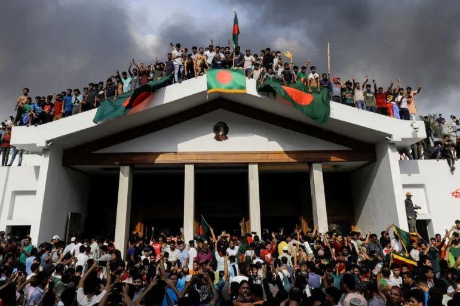

# Bangladesh in Crisis: How a Political Collapse in Dhaka Hits Canadian Garment Imports

**Published:** August 8, 2024  
**Category:** Industry

Sheikh Hasina resigned and fled Bangladesh on August 5 after weeks of student-led protests. Bangladesh is the world's second-largest garment exporter. Here is the supply chain ripple for Canadian retail.

[Read it on keylinktransport.ca](https://www.keylinktransport.ca/blog/bangladesh-crisis-canadian-textile-imports-august-2024) | [Page source](../site/blog/bangladesh-crisis-canadian-textile-imports-august-2024.html)
