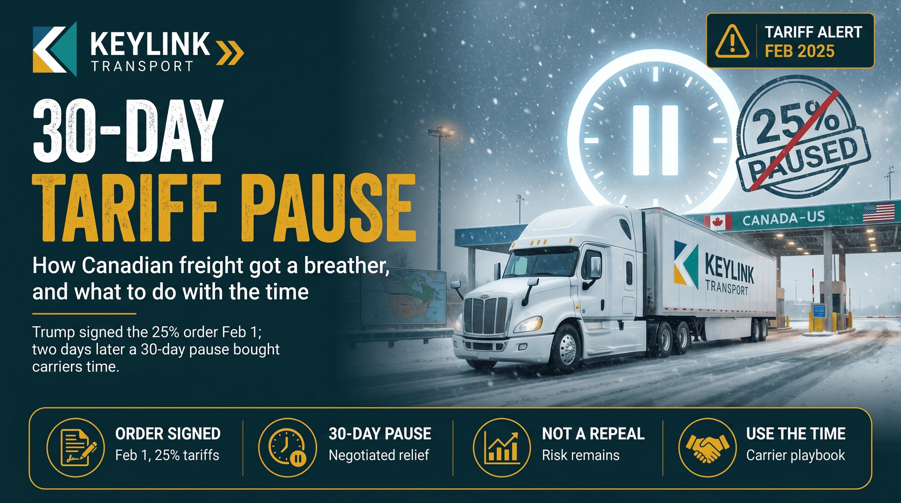

# The 30-Day Tariff Pause: How Canadian Freight Got a Breather

**Published:** February 12, 2025  
**Category:** Industry

Trump signed the 25% tariff order on February 1. Two days later, Trudeau and Sheinbaum negotiated a 30-day pause. Here is what Canadian carriers should be doing with the time.

[Read it on keylinktransport.ca](https://www.keylinktransport.ca/blog/tariff-pause-canadian-freight-feb-2025) | [Page source](../site/blog/tariff-pause-canadian-freight-feb-2025.html)
