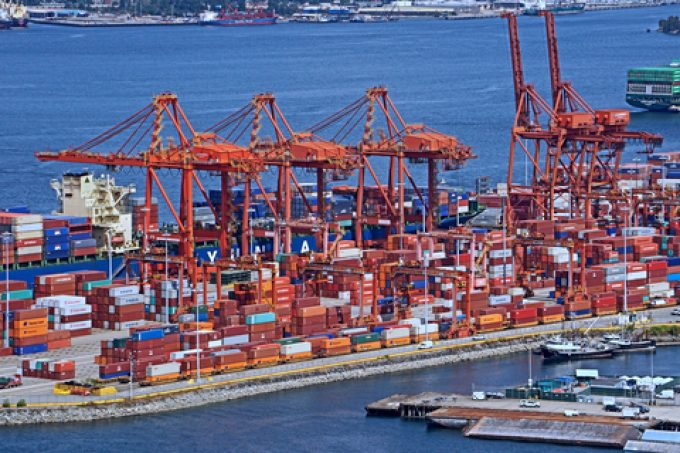

# Port of Vancouver Congestion and the Ripple Effect on BC Inland Freight

**Published:** May 20, 2025  
**Category:** Industry

The Port of Vancouver handles $290 billion in annual trade, but congestion, rail bottlenecks, and lingering effects of the 2023 port strike are cascading into inland freight delays across BC. Here is what shippers need to know.

[Read it on keylinktransport.ca](https://www.keylinktransport.ca/blog/port-vancouver-congestion-2025) | [Page source](../site/blog/port-vancouver-congestion-2025.html)
