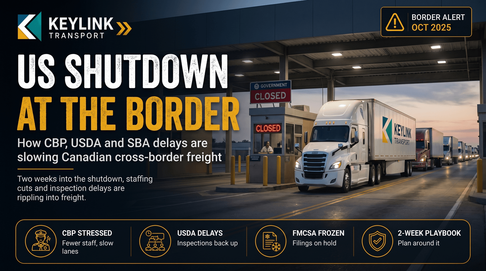

# US Government Shutdown and Cross-Border Freight: What's Slowing at the Border

**Published:** October 15, 2025  
**Category:** Industry

The US federal government shut down at midnight October 1. Two weeks in, CBP staffing reductions, USDA inspection delays and SBA financing freezes are rippling into Canadian cross-border freight.

[Read it on keylinktransport.ca](https://www.keylinktransport.ca/blog/us-government-shutdown-cross-border-freight-october-2025) | [Page source](../site/blog/us-government-shutdown-cross-border-freight-october-2025.html)
