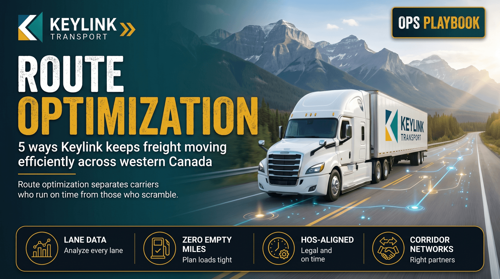

# 5 Ways to Optimize Your Freight Routes for Maximum Efficiency

**Published:** October 22, 2025  
**Category:** Logistics

Small routing decisions compound into major cost savings over time. These five tactics reduce empty miles, cut dwell time, and improve on-time delivery rates.

[Read it on keylinktransport.ca](https://www.keylinktransport.ca/blog/optimize-freight-routes) | [Page source](../site/blog/optimize-freight-routes.html)
