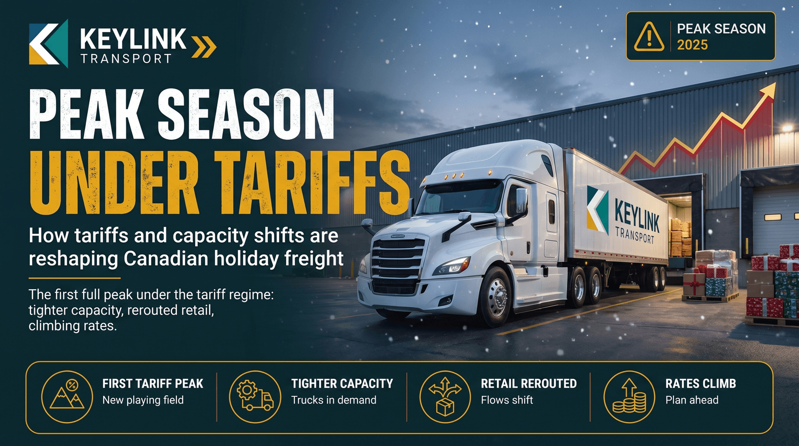

# Peak Season 2025: How Tariffs and Capacity Shifts Are Reshaping Canadian Holiday Freight

**Published:** November 4, 2025  
**Category:** Industry

The first full peak under the Trump tariff regime. Capacity is tighter, retail flows are rerouted, rates are climbing. Here is what Canadian shippers need to know before December.

[Read it on keylinktransport.ca](https://www.keylinktransport.ca/blog/peak-season-2025-tariffs-capacity) | [Page source](../site/blog/peak-season-2025-tariffs-capacity.html)
