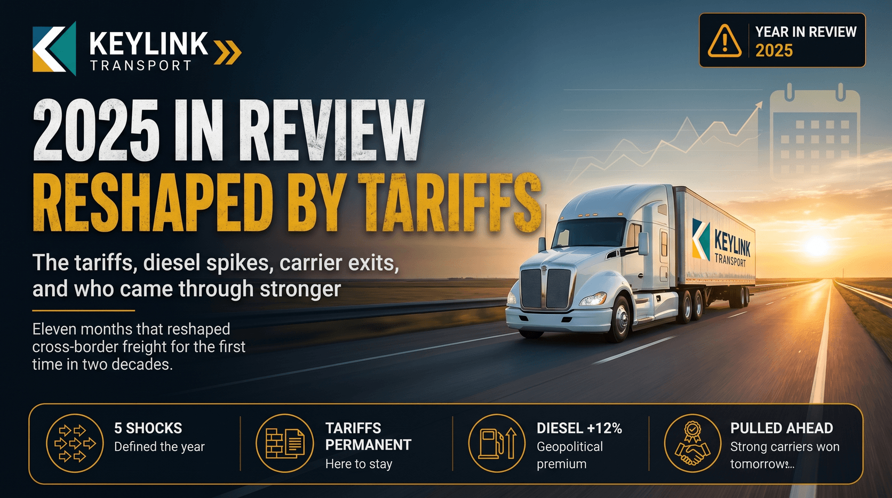

# 2025 in Review: The Year Canadian Trucking Was Reshaped by Tariffs

**Published:** December 9, 2025  
**Category:** Industry

Eleven months into the most consequential year in cross-border freight in two decades. The tariffs, the diesel spikes, the carrier exits, and the carriers who came through stronger.

[Read it on keylinktransport.ca](https://www.keylinktransport.ca/blog/2025-canadian-trucking-year-in-review) | [Page source](../site/blog/2025-canadian-trucking-year-in-review.html)
