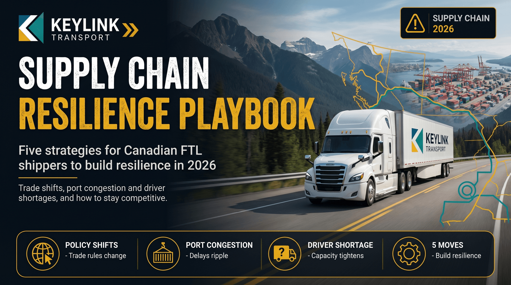

# Navigating Supply Chain Disruptions: Strategies for Canadian Shippers

**Published:** January 7, 2026  
**Category:** Logistics

Global disruptions have exposed real vulnerabilities in freight networks. These are the proven strategies Canadian shippers use to stay ahead when lanes get unpredictable.

[Read it on keylinktransport.ca](https://www.keylinktransport.ca/blog/supply-chain-disruptions) | [Page source](../site/blog/supply-chain-disruptions.html)
