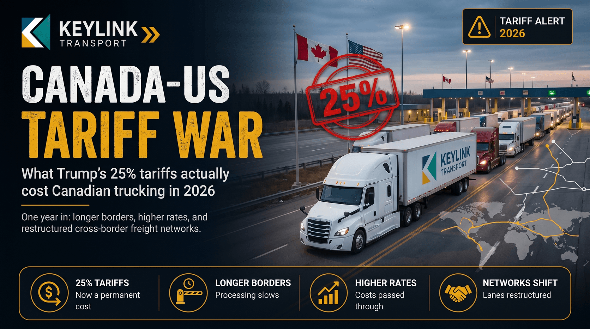

# The Canada-US Tariff War: What It Actually Costs Canadian Trucking in 2026

**Published:** March 18, 2026  
**Category:** Industry

Border wait times up. Cross-border volumes down. Rates climbing. One year into Trump's 25% tariffs on Canadian goods, here is the full cost breakdown for carriers and shippers.

[Read it on keylinktransport.ca](https://www.keylinktransport.ca/blog/canada-us-tariff-impact) | [Page source](../site/blog/canada-us-tariff-impact.html)
