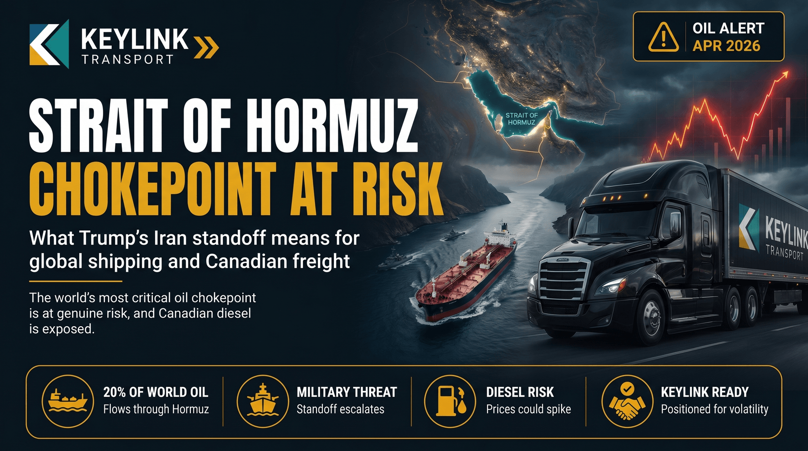

# The Strait of Hormuz Crisis: What Trump's Iran Standoff Means for Global Shipping and Canadian Freight

**Published:** April 15, 2026  
**Category:** Industry

21 million barrels of oil transit the Strait of Hormuz every single day. Trump's maximum pressure campaign against Iran has placed this shipping lane at genuine risk. Here is what it means for Canadian fuel prices and freight costs.

[Read it on keylinktransport.ca](https://www.keylinktransport.ca/blog/hormuz-strait-shipping-crisis) | [Page source](../site/blog/hormuz-strait-shipping-crisis.html)
