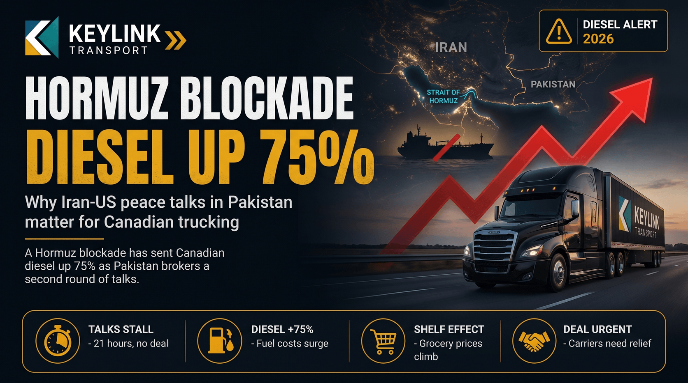

# Iran-US Peace Talks in Pakistan: Why the Hormuz Blockade Must End for Canadian Trucking

**Published:** April 19, 2026  
**Category:** Industry

Pakistan is brokering a second round of Iran-US talks as the Hormuz blockade pushes Canadian diesel up 75%. Here is why these negotiations matter more to freight than any policy Ottawa has announced.

[Read it on keylinktransport.ca](https://www.keylinktransport.ca/blog/iran-us-pakistan-peace-talks) | [Page source](../site/blog/iran-us-pakistan-peace-talks.html)
