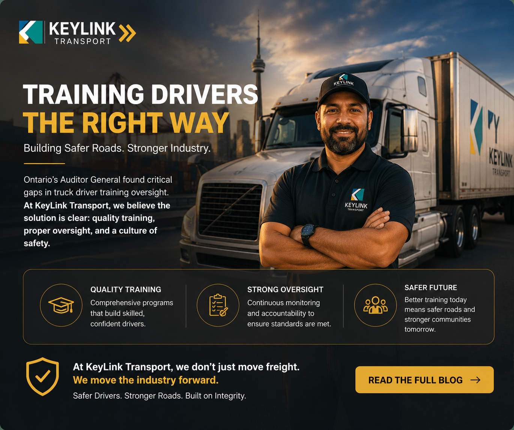

# Ontario's Truck Driver Training Audit: Why the Auditor General's Findings Should Change How Carriers Hire

**Published:** May 13, 2026  
**Category:** Safety

Ontario's auditor general found private colleges falsifying records and licensing drivers who never learned left turns or emergency stops. Here is what carriers, shippers, and the industry should be doing in response.

[Read it on keylinktransport.ca](https://www.keylinktransport.ca/blog/ontario-truck-driver-training-audit-2026) | [Page source](../site/blog/ontario-truck-driver-training-audit-2026.html)
