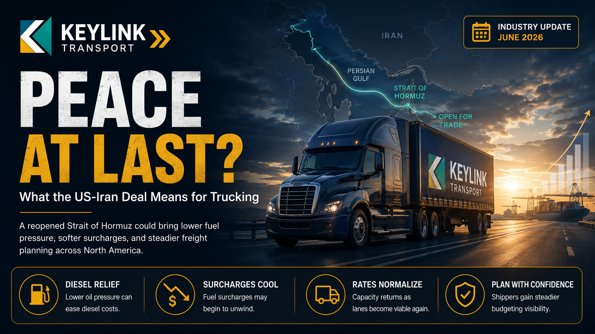

# Peace at Last? What the US-Iran Deal and a Reopened Strait of Hormuz Mean for Trucking

**Published:** June 15, 2026  
**Category:** Industry

The US and Iran have reached a deal to reopen the Strait of Hormuz and end the conflict, and oil is already down 20% from its 2026 peak. Here is what the peace deal could mean for diesel, freight capacity, and trucking rates, and how shippers should play the turn.

[Read it on keylinktransport.ca](https://www.keylinktransport.ca/blog/iran-peace-deal-hormuz-reopens-trucking-june-2026) | [Page source](../site/blog/iran-peace-deal-hormuz-reopens-trucking-june-2026.html)
