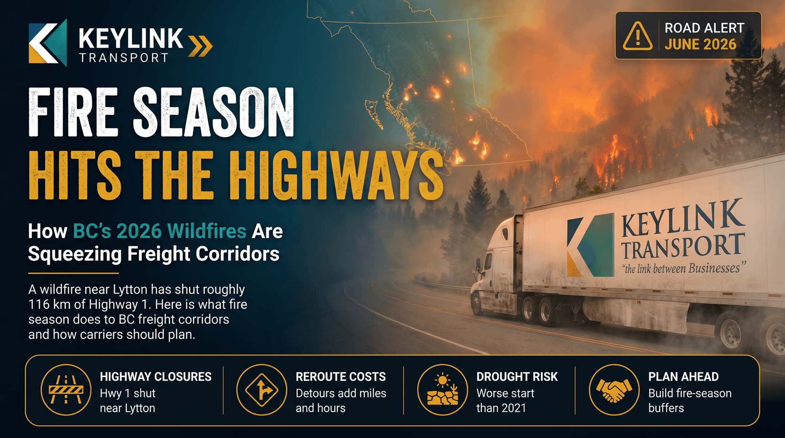

# Fire Season Hits the Highways: How BC's 2026 Wildfires Are Squeezing Freight Corridors

**Published:** June 22, 2026  
**Category:** Logistics

A wildfire near Lytton has already shut roughly 116 km of Highway 1, and BC Wildfire Service says 2026 is starting on worse drought than 2021. Here is what fire season does to BC freight corridors, what a closure costs a truck, and how carriers and shippers should plan around it.

[Read it on keylinktransport.ca](https://www.keylinktransport.ca/blog/bc-wildfire-season-freight-corridors-2026) | [Page source](../site/blog/bc-wildfire-season-freight-corridors-2026.html)
