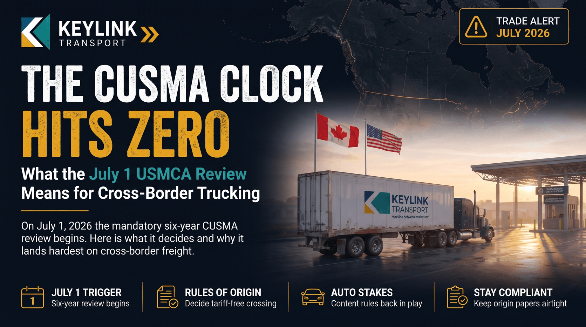

# The CUSMA Clock Hits Zero: What the July 1 USMCA Review Means for Canadian Cross-Border Trucking

**Published:** June 29, 2026  
**Category:** Industry

On July 1, 2026 the mandatory six-year review of CUSMA (USMCA) begins. Here is what the joint review actually decides, why it lands hardest on cross-border trucking, and how Canadian shippers and carriers should prepare.

[Read it on keylinktransport.ca](https://www.keylinktransport.ca/blog/cusma-usmca-2026-joint-review-cross-border-trucking) | [Page source](../site/blog/cusma-usmca-2026-joint-review-cross-border-trucking.html)
