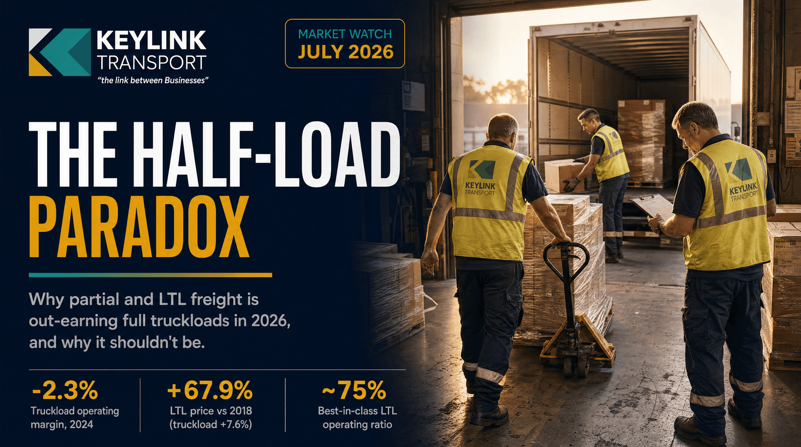

# The Half-Load Paradox: Why Partial and LTL Freight Is Out-Earning Full Truckloads in 2026

**Published:** July 6, 2026  
**Category:** Industry

Partial and LTL half loads are out-earning full truckloads in 2026. Here is the data behind the inversion, why it is a market distortion rather than real efficiency, and what it means for Canadian shippers.

[Read it on keylinktransport.ca](https://www.keylinktransport.ca/blog/half-load-premium-partial-ltl-vs-truckload-2026) | [Page source](../site/blog/half-load-premium-partial-ltl-vs-truckload-2026.html)
