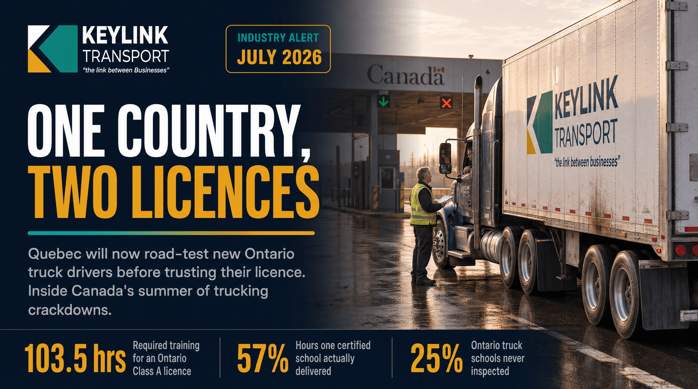

# One Country, Two Licences: Quebec Stops Trusting Ontario's New Truck Drivers, and the Crackdown Is Just Starting

**Published:** July 10, 2026  
**Category:** Industry

As of July 9, 2026, Quebec road-tests new Ontario truck drivers before recognizing their licence. The scathing Ontario training audit behind it, the CRA's Driver Inc crackdown, and what Canada's trucking compliance summer means for shippers.

[Read it on keylinktransport.ca](https://www.keylinktransport.ca/blog/quebec-ontario-truck-licence-crackdown-2026) | [Page source](../site/blog/quebec-ontario-truck-licence-crackdown-2026.html)
