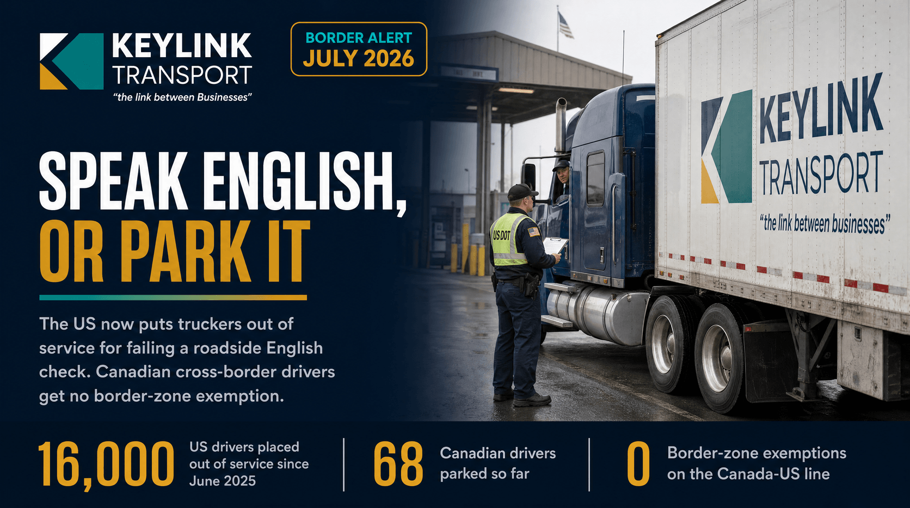

# Speak English, or Park It: What the US Roadside Language Crackdown Means for Canadian Cross-Border Truckers

**Published:** July 11, 2026  
**Category:** Industry

Since June 2025 the US puts commercial drivers out of service for failing a roadside English check, and Canadian cross-border drivers get no border-zone exemption like the US-Mexico line has. What the FMCSA ELP rule means, what it costs, and whether Canada should follow.

[Read it on keylinktransport.ca](https://www.keylinktransport.ca/blog/us-english-proficiency-enforcement-canadian-truckers-2026) | [Page source](../site/blog/us-english-proficiency-enforcement-canadian-truckers-2026.html)
