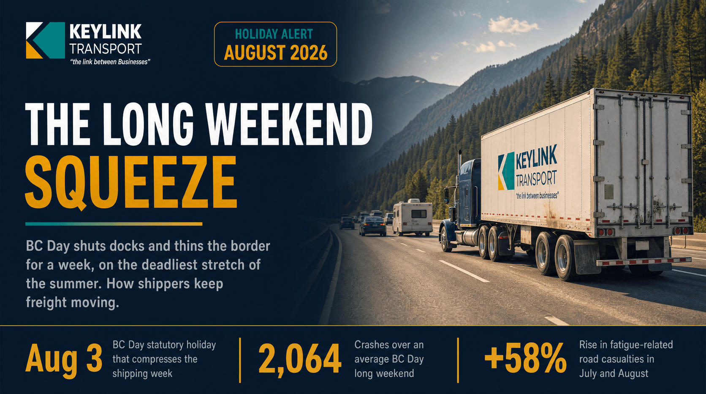

# The Long Weekend Squeeze: How BC Day Bottlenecks Canadian Freight, and How Keylink Plans Around It

**Published:** July 31, 2026  
**Category:** Logistics

BC Day on Monday, August 3, 2026 closes docks, thins the border, and lands on the deadliest driving stretch of summer. Here is how Canada's August long weekend compresses the freight week and how Keylink mitigates the risk.

[Read it on keylinktransport.ca](https://www.keylinktransport.ca/blog/bc-day-long-weekend-freight-2026) | [Page source](../site/blog/bc-day-long-weekend-freight-2026.html)
