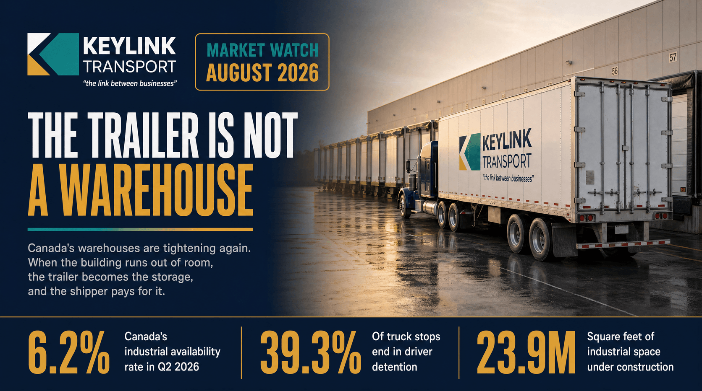

# The Trailer Is Not a Warehouse: Canada's 2026 Industrial Space Squeeze and the Freight Bill Nobody Quotes

**Published:** August 3, 2026  
**Category:** Industry

Canada's industrial availability rate sat at 6.2% in Q2 2026, and Toronto, Calgary, and Vancouver are tighter still. When warehouse space runs short, trailers become storage and shippers pay for it in detention, dwell, and lost capacity. The numbers, and what to do about them.

[Read it on keylinktransport.ca](https://www.keylinktransport.ca/blog/canada-warehouse-squeeze-freight-detention-2026) | [Page source](../site/blog/canada-warehouse-squeeze-freight-detention-2026.html)
