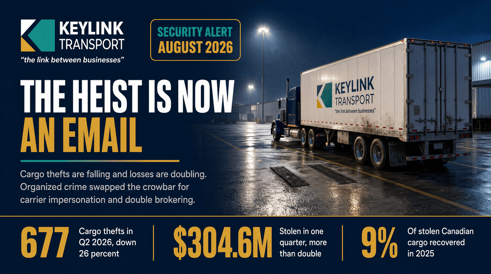

# The Heist Is Now an Email: How Freight Fraud Replaced the Cargo Heist in Canada

**Published:** August 6, 2026  
**Category:** Industry

Cargo thefts across the US and Canada fell 26% in Q2 2026 while losses more than doubled to $304.6 million. Organized crime traded the crowbar for carrier impersonation, double brokering, and fictitious pickups. What the data shows, and how shippers verify who is actually holding their freight.

[Read it on keylinktransport.ca](https://www.keylinktransport.ca/blog/canada-freight-fraud-carrier-impersonation-2026) | [Page source](../site/blog/canada-freight-fraud-carrier-impersonation-2026.html)
