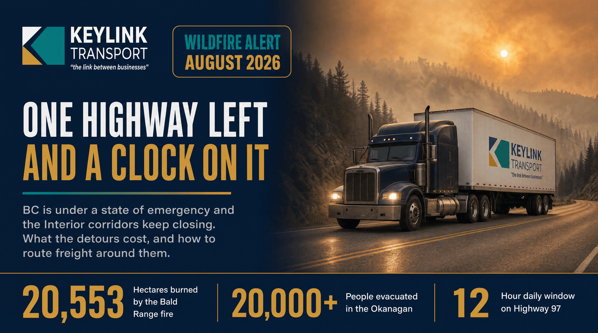

# One Highway Left: How BC's August Wildfires Are Rerouting Freight, and What the Detours Cost

**Published:** August 17, 2026  
**Category:** Logistics

BC has been under a provincial state of emergency since August 8 with more than 100 fires burning and 20,000 people evacuated. Highway 1, Highway 3, and Highway 97 all closed this summer, leaving the Coquihalla carrying the load. What the closures cost industry, and how carriers reroute around them.

[Read it on keylinktransport.ca](https://www.keylinktransport.ca/blog/bc-wildfire-highway-closures-freight-rerouting-2026) | [Page source](../site/blog/bc-wildfire-highway-closures-freight-rerouting-2026.html)
