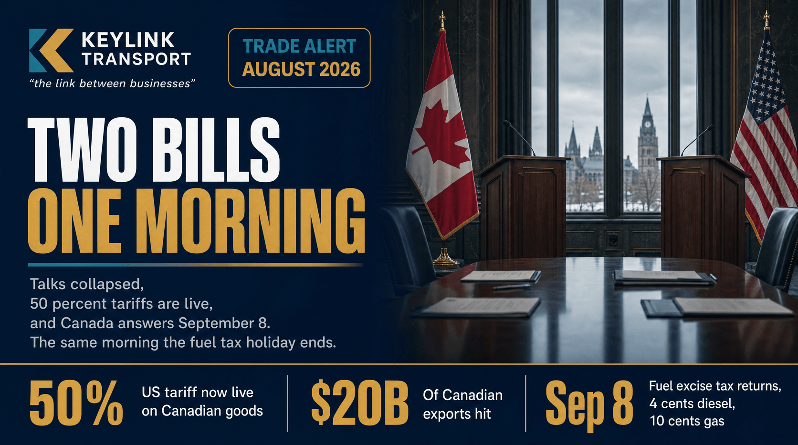

# Two Bills, One Morning: What the Carney-Trump Tariff War Does to Goods and Fuel Prices

**Published:** August 24, 2026  
**Category:** Industry

US 50% tariffs on about US$20 billion of Canadian goods took effect August 22, and Canada retaliates September 8, the same day the federal fuel tax holiday ends. What the stacking does to goods prices, diesel, and cross-border freight, plus what shippers should do before the deadline.

[Read it on keylinktransport.ca](https://www.keylinktransport.ca/blog/carney-trump-tariffs-goods-fuel-prices-2026) | [Page source](../site/blog/carney-trump-tariffs-goods-fuel-prices-2026.html)
