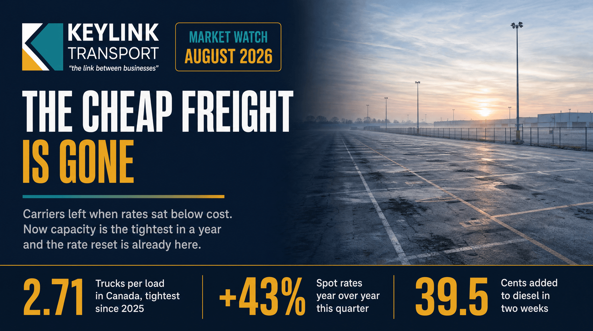

# The Cheap Freight Is Gone: Diesel Spikes, Capacity Tightens, and the Rate Reset Is Already Here

**Published:** August 31, 2026  
**Category:** Industry

Canadian truck-to-load ratios hit 2.71 in July, the tightest in a year, diesel jumped 39.5 cents in two weeks, and truckload spot rates are running 43% above last year. What the 2026 cost reset means for 2027 contracts, and what shippers should do before renewal season.

[Read it on keylinktransport.ca](https://www.keylinktransport.ca/blog/canada-freight-rate-reset-diesel-capacity-2026) | [Page source](../site/blog/canada-freight-rate-reset-diesel-capacity-2026.html)
