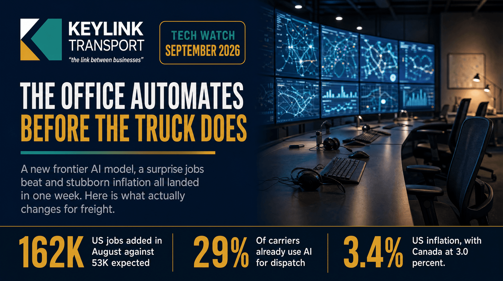

# The Office Automates Before the Truck Does: GPT-6 Astra, a 162,000-Job Month, and What AI Really Changes in Freight

**Published:** September 4, 2026  
**Category:** Industry

OpenAI shipped GPT-6 Astra on September 3, US payrolls beat forecasts by 109,000 in August, and inflation is still above 3% on both sides of the border. Where AI is genuinely working in freight today, where autonomy actually stands, and what it means for costs.

[Read it on keylinktransport.ca](https://www.keylinktransport.ca/blog/ai-automation-inflation-jobs-freight-2026) | [Page source](../site/blog/ai-automation-inflation-jobs-freight-2026.html)
