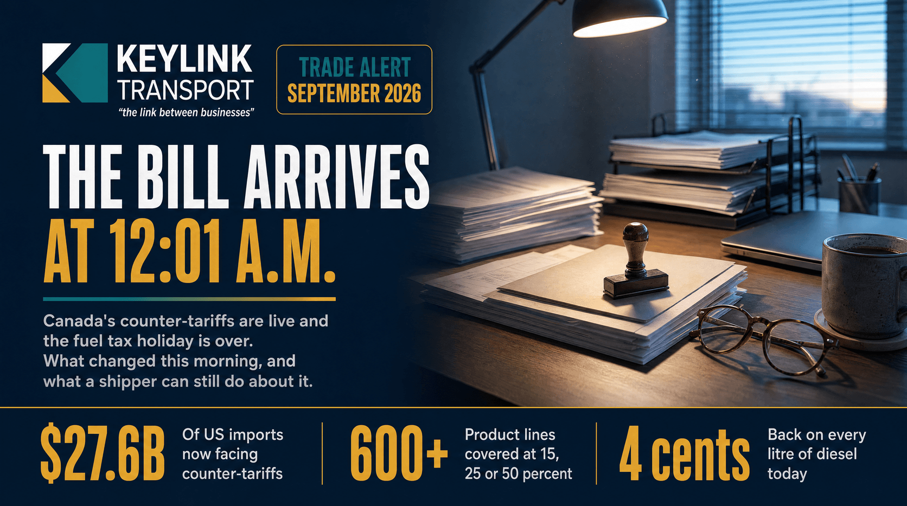

# The Bill Arrives at 12:01 a.m.: Canada's Counter-Tariffs Are Live and the Fuel Tax Is Back

**Published:** September 8, 2026  
**Category:** Industry

Canada's counter-tariffs hit C$27.6 billion of US imports at 12:01 a.m. today, covering more than 600 product lines at 15, 25 and 50 percent, and the federal fuel excise tax returned the same morning. What changed, what is exempt, and a 48-hour checklist for shippers.

[Read it on keylinktransport.ca](https://www.keylinktransport.ca/blog/canada-counter-tariffs-september-8-2026-shipper-guide) | [Page source](../site/blog/canada-counter-tariffs-september-8-2026-shipper-guide.html)
