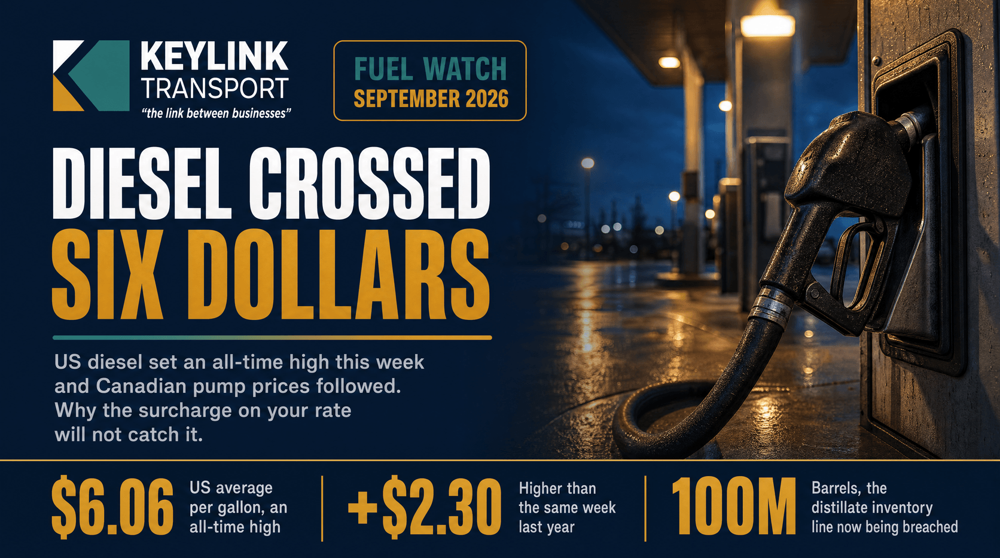

# Diesel Crossed Six Dollars: Why Your Fuel Surcharge Will Not Catch It

**Published:** September 11, 2026  
**Category:** Industry

US retail diesel hit an all-time high above $6 a gallon on September 11, up roughly $2.30 from a year ago, with distillate inventories forecast below the five-year low into 2027. Why the surcharge in most freight agreements structurally underpays during a spike, and the four things to check in yours.

[Read it on keylinktransport.ca](https://www.keylinktransport.ca/blog/diesel-record-fuel-surcharge-canada-2026) | [Page source](../site/blog/diesel-record-fuel-surcharge-canada-2026.html)
