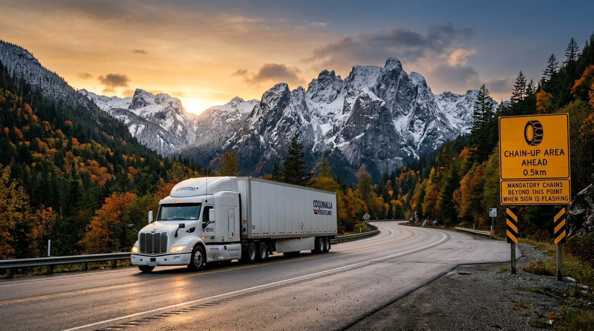

# The October 1 Chain Law Clock: Coquihalla, Rogers Pass, and Why Shippers Pay for Winter in September

**Published:** September 18, 2026  
**Category:** Logistics

On October 1, 2026, BC's mandatory commercial vehicle chain-up and winter tire laws take legal effect across all interior mountain corridors. Why pass transit times inflate by 35%, what CVSE inspections mean for capacity, and how shippers must adjust buffers before October.

[Read it on keylinktransport.ca](https://www.keylinktransport.ca/blog/bc-mountain-pass-chain-up-regulations-october-2026) | [Page source](../site/blog/bc-mountain-pass-chain-up-regulations-october-2026.html)
