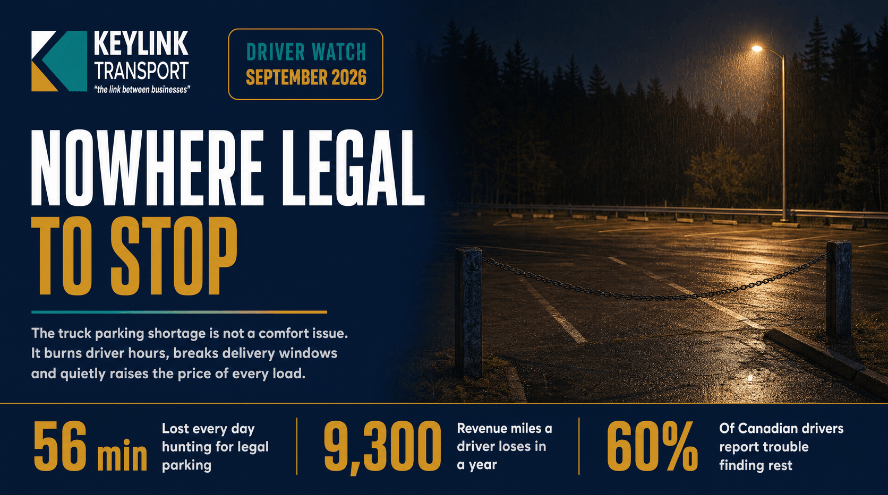

# Nowhere Legal to Stop: What Canada's Truck Parking Shortage Costs Every Load

**Published:** September 23, 2026  
**Category:** Logistics

Drivers lose about 56 minutes a day hunting for legal parking, worth roughly 9,300 revenue miles and $4,600 in wages a year, and more than 60% of Canadian drivers report trouble finding rest. Why the shortage is a capacity problem rather than a comfort one, and the five levers shippers control.

[Read it on keylinktransport.ca](https://www.keylinktransport.ca/blog/truck-parking-shortage-canada-2026) | [Page source](../site/blog/truck-parking-shortage-canada-2026.html)
