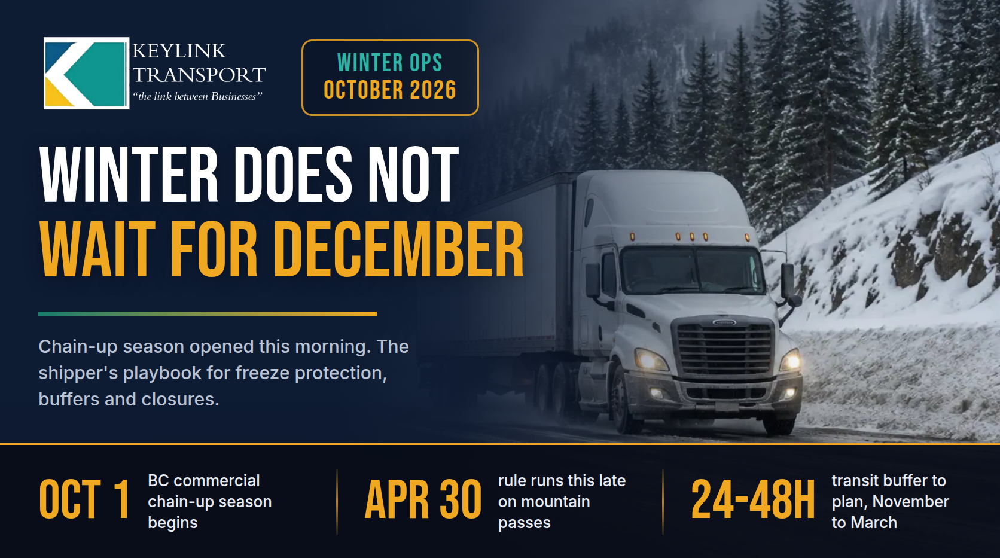

# Winter Does Not Wait for December: The October Playbook for Cold-Season Freight

**Published:** October 1, 2026  
**Category:** Logistics

BC's commercial chain-up season began October 1 and runs to April 30 on the mountain passes. What winter actually does to a freight lane, which products need protect-from-freeze service, how much transit buffer to build, and what the season does to rates in a record diesel year.

[Read it on keylinktransport.ca](https://www.keylinktransport.ca/blog/winter-freight-prep-canadian-shippers-2026) | [Page source](../site/blog/winter-freight-prep-canadian-shippers-2026.html)
